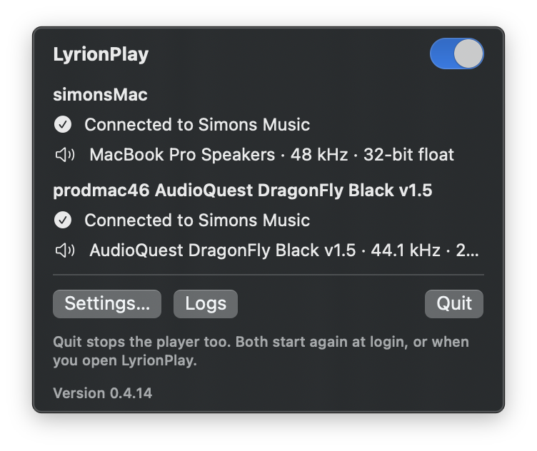
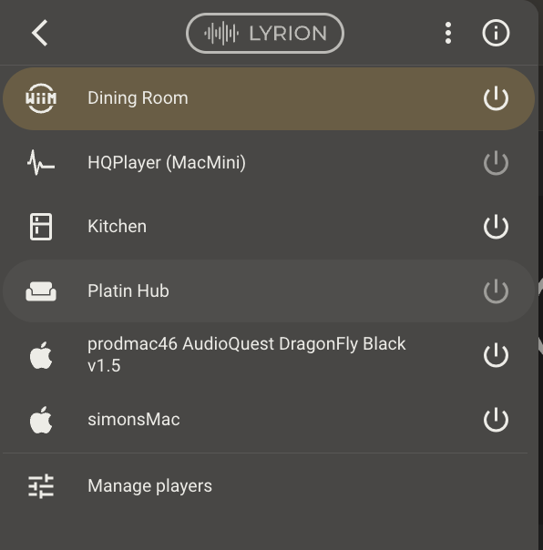
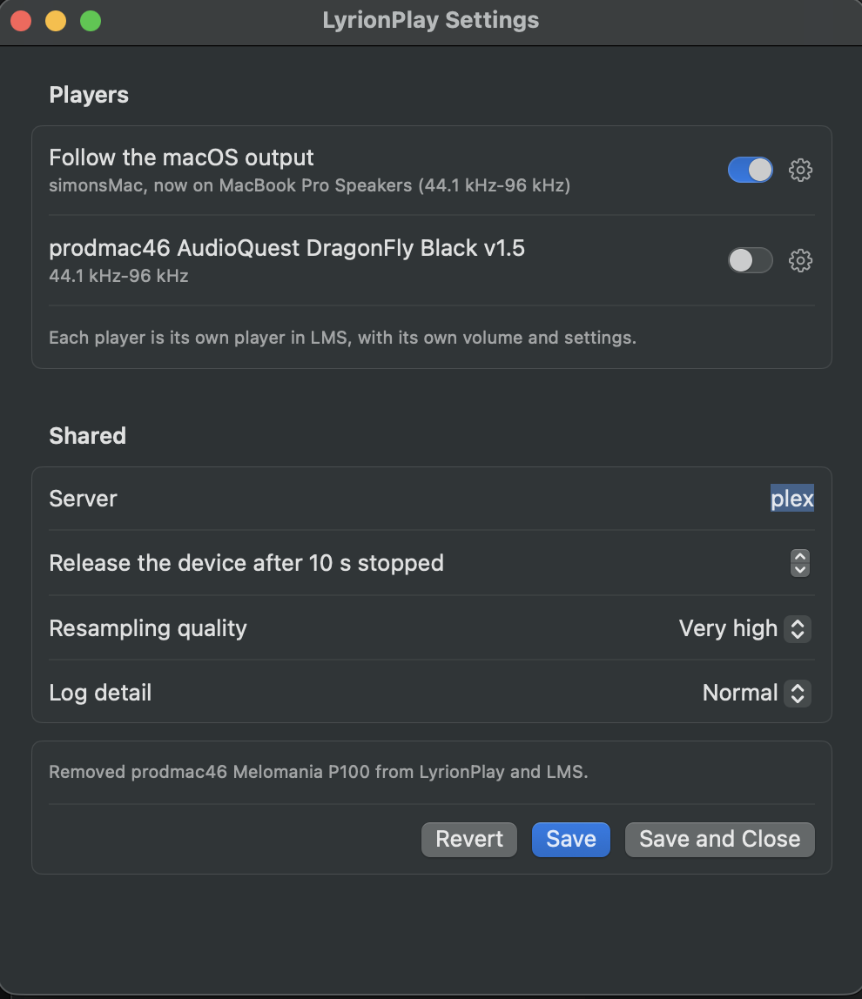
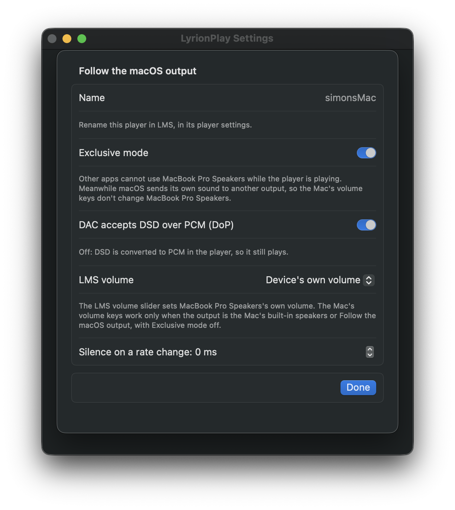
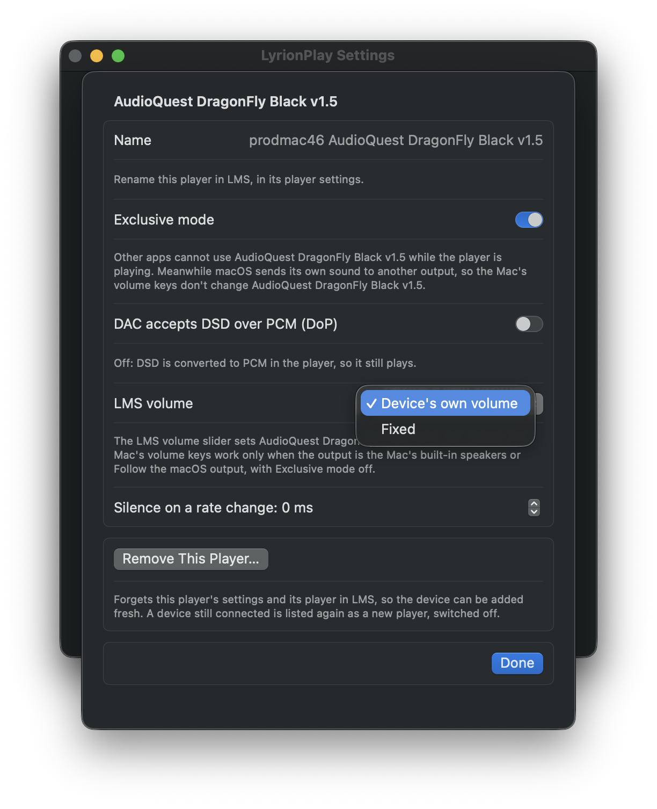

# LyrionPlay

**A bit-perfect Lyrion Music Server player for Apple Silicon Macs, built on squeezelite.**

LyrionPlay plays music from your Lyrion Music Server (LMS) on your Mac. LMS sees it as an
ordinary squeezelite player. It lives in your menu bar, and its player runs in the background.

## Features

| Feature | What it gives you |
|---|---|
| **Bit-perfect on a DAC** | Exclusive (hog) mode, with the DAC switched to each track's sample rate. Samples reach the DAC unchanged at full volume. |
| **Told about your DAC** | LMS learns your DAC's highest sample rate and transcodes anything above it. Rates the DAC lacks below that are resampled in the player, only when needed. |
| **DSD** | Sent as DoP to DACs you switch DoP on for (macOS can't tell which accept it), and converted to PCM for the rest. |
| **LMS replay gain** | Applied by the player, exactly as LMS sends it. |
| **Volume, your choice per player** | *Device's own volume*: the LMS slider moves your Mac's volume or your DAC's hardware volume, and a change made on the Mac moves the LMS slider (the volume keys when the output is the Mac's built-in speakers or Follow the macOS output, with Exclusive mode off). *Software*, where the Mac can't set the device's volume: the player scales the samples. *Fixed*, on a DAC: LyrionPlay sets LMS's fixed output level for you; a DAC whose volume the Mac sets holds the level LMS had, and on any other you use the DAC's or amplifier's own volume. |
| **One player, or one per device** | Use *Follow the macOS output* as a single player that plays wherever your Mac's sound goes, or switch a DAC or other output on as a player of its own, or both. Each is its own player in LMS, with its own name, volume and settings. |
| **Menu bar app** | Switch LyrionPlay on and off, see what each player is doing (the server, the device and the rate it plays at, the DSD rate for DoP), and set each player's options. |
| **Signed by you** | Every user signs their own copy with a certificate made on their own Mac, so no Apple developer account is involved. |

## One player, or one per device

You choose how LyrionPlay appears in LMS, in Settings:

- **One player for everything.** Leave only *Follow the macOS output* on. It plays to whatever
  output your Mac is using (the built-in speakers, headphones, a USB DAC), and follows when you
  change the Mac's output. LMS sees one player.
- **A player for each device.** Switch a DAC, or any other output, on in Settings and it becomes a
  player of its own in LMS. It always plays to that device, with its own name, volume and options.
  Play different music on two outputs at once, or sync them in LMS.
- **Both.** *Follow the macOS output* carries on beside the device players. When the Mac's output is
  a device that has its own player on, *Follow the macOS output* plays to the Mac's built-in output
  instead, so two players never share one device.

## What it looks like

**The menu bar** shows each player that is on: its server, and the device with the rate it plays at. **In LMS** each is an ordinary player, shown in Material with an Apple icon.

 

**Settings** lists *Follow the macOS output* and every other output the Mac has. Switch a player on or off, and open its options with the cog. The server and the rest are set once for all players.



**A player's options:** exclusive mode, DoP, how the LMS volume slider works, and silence on a rate change. A DAC whose volume the Mac sets offers *Device's own volume* and *Fixed*.

 

## Requirements

- A Mac with Apple Silicon (M1 or later), running macOS 14 Sonoma or later.
- Lyrion Music Server on your network.

## Install

Download the [latest release](https://github.com/SimonArnold002/LyrionPlay/releases/latest), then follow [INSTALL.md](INSTALL.md). It takes one Terminal command.

## How it works

| part | what it does |
|---|---|
| `engine/` | squeezelite with a native CoreAudio output added (`output_coreaudio.c`): exclusive mode, per-track rate and format switching, DoP, the device's volume in both directions, and a report of what it plays for the menu. |
| `app/Sources/Agent` | A background launch agent. It reads the devices' abilities from the engine, runs one engine for each player that is on and keeps it running, passes volume changes made on the Mac to LMS, and keeps LMS's fixed-volume setting in step with each device's choice. |
| `app/Sources/App` | The menu bar app: On/Off, status, settings. |
| `scripts/` | `build.sh` builds the app and the release. `test.sh` is the regression suite. `install.sh` and `uninstall.sh` are what users run. |

## Building from source

You need Apple's Command Line Tools (`xcode-select --install`). Nothing else is installed
system-wide.

```
scripts/build.sh            # build and check
scripts/build.sh --install  # build, then install with your own certificate
scripts/build.sh --release  # build the two release zips (app, codec source) into dist/
scripts/test.sh             # the regression suite on its own
```

Every build runs the regression suite (`scripts/test.sh`) and stops if a test fails. It needs no
DAC, server or keychain: the CoreAudio output is tested against a fake audio system.

The first build downloads pinned, checksummed sources and compiles them for Apple Silicon:
CMake, and the codec libraries (FLAC, Ogg, Vorbis, Opus, mpg123, FAAD2, soxr, ALAC). This takes a
while.

## Credits

**LyrionPlay's audio engine is [squeezelite](https://github.com/ralph-irving/squeezelite).**
- **Adrian Smith** wrote it (2012–2015).
- **Ralph Irving** has maintained and developed it since 2015, with many contributors.
- Squeezelite does everything that makes this a real LMS player: the slimproto protocol,
  decoding, gapless playback, sync groups, resampling, DSD and DoP.
- LyrionPlay adds a macOS output to it. Every change to squeezelite's own files is listed in
  [engine/UPSTREAM.md](engine/UPSTREAM.md).
- Thank you, Adrian and Ralph.

Squeezelite in turn contains:
- **dsd2pcm** by Sebastian Gesemann;
- the **Daphile** project's DSD patch.

Also used:

- **Codec libraries:** FLAC, Ogg and Vorbis (Xiph.Org), Opus and opusfile, mpg123, FAAD2,
  soxr, and Apple Lossless (ALAC).
- **The Music Player Daemon's** macOS output was a reference for CoreAudio's exclusive mode and
  format selection.
- **The icon** joins the play arrow from Google's
  [Material Symbols](https://fonts.google.com/icons) (Apache 2.0) to the Lyrion waveform from
  [LMS-Material](https://github.com/CDrummond/lms-material) by Craig Drummond (MIT).
- **[Lyrion Music Server](https://lyrion.org)** and its community.

Full notices ship inside the app, in `LyrionPlay.app/Contents/Resources/NOTICES.txt`, with the full text of each licence in the `licences` folder beside it.

LyrionPlay is not affiliated with the Lyrion Music Server project.

## Licence

- **The engine (`engine/`):** squeezelite's licence ([engine/LICENSE.txt](engine/LICENSE.txt)), the
  [GNU General Public License v3](app/Resources/licences/GPL-3.0.txt). The codec libraries linked
  into it keep their own licences (NOTICES.txt). Each release has its source under its tag
  `v<version>`, and the codecs' source as `LyrionPlay-<version>-codec-sources.zip` on its release page.
- **Everything else** (the menu bar app, the agent, the scripts and tools): the
  [MIT licence](LICENSE).
